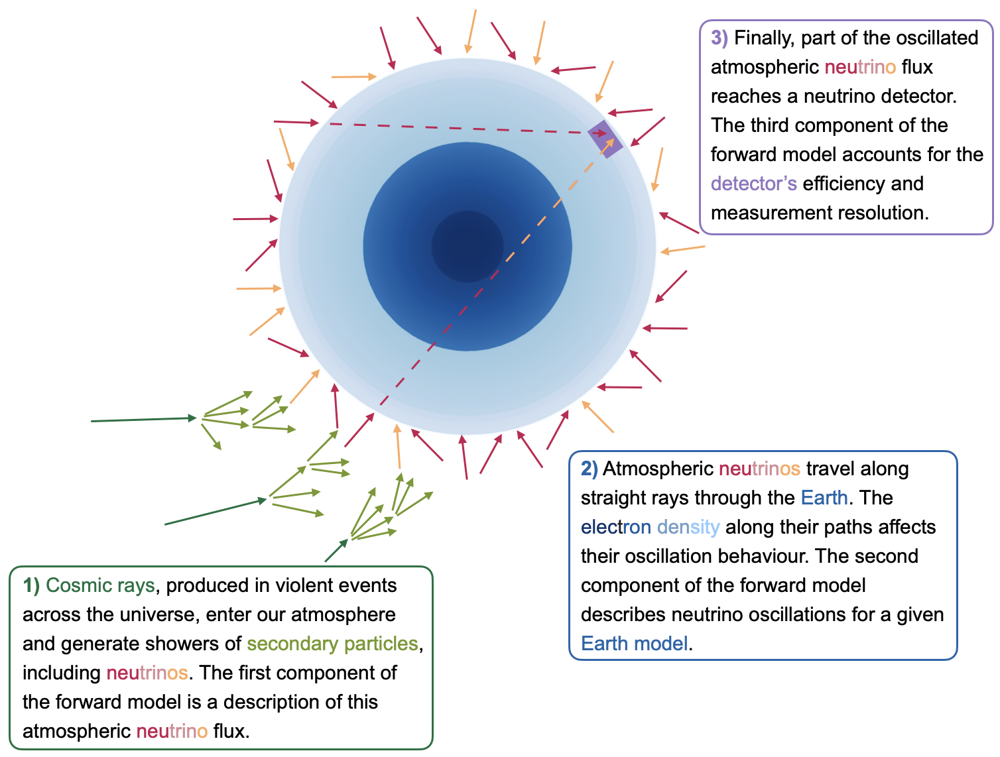

# The Forward Model

This folder contains the components of the forward model used to simulate neutrino data for neutrino oscillation tomography of the Earth (NOTE).

## Overview

The model is structured around four successive components:

  

- **Atmospheric Neutrino Flux:** Cosmic rays interact with Earth's atmosphere, producing showers of secondary particles, including neutrinos. This component describes the initial atmospheric neutrino flux.

- **Neutrino Oscillations:** As neutrinos propagate through Earth, the electron density along their trajectories influences their oscillation probabilities. This component models neutrino oscillations for a given Earth density profile.

- **Neutrino Interactions:** This component models neutrino interactions in the detector material to predict the rates of *interacting neutrino events*.

- **Neutrino Detection:** The final component models the detector response, accounting for detection efficiency and measurement resolution to predict the *observed* or *detected neutrino events*.

